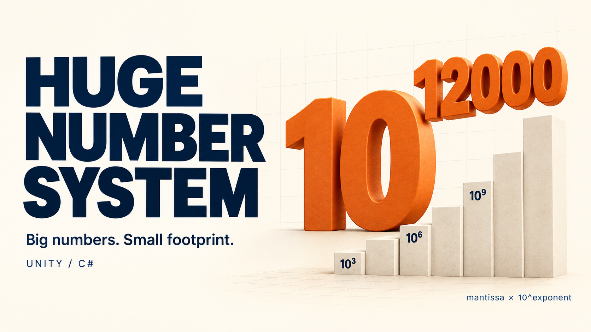
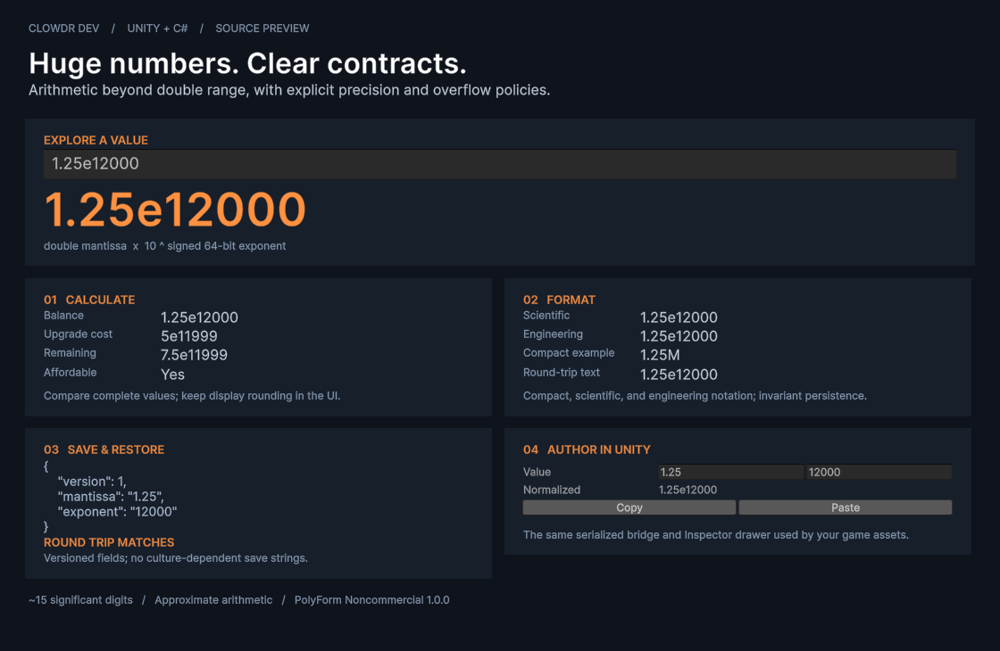

# Huge Number System

A C# numeric library for incremental games and other systems whose values exceed `double` range. `HugeNumber` stores a normalized `double` mantissa and a signed 64-bit decimal exponent, with approximately 15 significant digits of relative precision.

This repository is a standalone Unity project and a source preview. The public namespace is `HugeNumberSystem.Numerics`. Consumers own their currencies, formulas, transactions, and save files.

## Requirements

- Unity Editor **6000.5.4f1** (the version currently verified).
- Unity Test Framework **1.7.0**, already declared in this project's package manifest.
- Windows PowerShell 5.1 or PowerShell 7 for the verification script.

Other Unity versions, IL2CPP, mobile, and WebGL have not been validated for this release. An interactive Editor showcase is included. UPM packaging, runtime example scenes, and Asset Store distribution are planned for a later phase.

## Explore in Unity

Open **Huge Number System > Showcase** in the Unity Editor. Enter a number such as `1.25e12000` to inspect arithmetic beyond `double` range, scientific and engineering formatting, a versioned JSON round trip, and the real serialized Inspector drawer.



The screenshot is captured from the included Editor window, using the library's public APIs. It can be reproduced from the menu after opening the project. The showcase is an Editor tool; it adds no runtime UI dependency to the numeric library.

## Get started

Clone this repository and open its root folder through Unity Hub. Unity restores the declared packages and generates the ignored `Library` and local editor folders.

```sh
git clone https://github.com/Clowdr-Dev/unity-huge-number-system.git
cd unity-huge-number-system
```

To use the source in an existing Unity project, copy `Assets/Scripts/Numerics` and its `.meta` file into your project's `Assets/Scripts` folder. Preserve the `.meta` files inside it. You can omit `Numerics/Tests` and `Tests.meta`; if you include them, install the Unity Test Framework. If your consuming scripts have their own assembly definition, add references to the Numerics assemblies they use. See the [integration guide](docs/usage.md#integrate-with-an-existing-unity-project).

```csharp
using System.Globalization;
using HugeNumberSystem.Numerics;
using HugeNumberSystem.Numerics.Presentation;

HugeNumber balance = HugeNumber.ParseInvariant("1.25e12000");
HugeNumber cost = HugeNumber.FromParts(5d, 11999L);
HugeNumber remaining = balance - cost;

var formatter = new HugeNumberFormatter();
var scientific = new HugeNumberFormatOptions(
    HugeNumberNotation.Scientific, CultureInfo.InvariantCulture);

string label = formatter.Format(remaining, scientific); // "7.50e11999"
string roundTripText = remaining.ToInvariantString();  // "7.5e11999"
```

## Capabilities and limits

- Immutable values, comparison, arithmetic, integer and real powers, and logarithms.
- Invariant parsing and round-trip text; explicit checked primitive conversions.
- Compact (`K`, `M`, `B`, `T`, `aa`, ...), scientific, and engineering formatting.
- Versioned save DTOs with invariant string fields.
- A Unity serialized bridge and Inspector drawer with validation, normalized preview, and copy/paste.

This is approximate arithmetic. Adding or subtracting an operand 17 or more exponent places below the larger operand has no effect. Exact unit accounting is not guaranteed, particularly for large integers. Real powers and logarithms lose precision as exponents grow; real powers reject logarithms at or beyond `2^53`. The parser accepts ordinary and scientific invariant numbers, not localized input or compact suffixes. Exponent overflow throws rather than saturating.

Use full `HugeNumber` comparisons for affordability, and use invariant text or save DTOs for persistence. Display strings are presentation only. Read the [usage guide](docs/usage.md), [API reference](docs/api.md), and [design contract](docs/huge-number-system-design.md) for the detailed policies.

## Verify

Close this project in the Unity Editor, then run from the repository root:

```powershell
powershell -NoProfile -ExecutionPolicy Bypass -File scripts/verify.ps1
```

The script runs all Numerics EditMode tests and the persistence PlayMode suite sequentially. It locates the pinned Editor in the default Unity Hub installation on Windows or macOS. For another installation, supply its executable:

```powershell
pwsh -NoProfile -File scripts/verify.ps1 -UnityPath '/path/to/Unity'
```

Each run saves fresh XML results, logs, and `summary.json` beneath `artifacts/verification/`. The command exits with code 1 for failed, skipped, empty, missing, or malformed results, a nonzero Unity exit, or a timeout. See [verification instructions](docs/verification.md) for suite selection, troubleshooting, and verification scope.

## Repository layout

| Folder | Responsibility |
| --- | --- |
| `Assets/Scripts/Numerics/Core` | Pure C# numeric representation, math, parsing, and conversions |
| `Assets/Scripts/Numerics/Presentation` | Pure C# formatting and suffix providers |
| `Assets/Scripts/Numerics/Persistence` | Pure C# save DTOs and conversion |
| `Assets/Scripts/Numerics/Authoring` | Unity serialized bridge and validation |
| `Assets/Scripts/Numerics/Editor` | Editor-only property drawer and clipboard support |
| `Assets/Scripts/Numerics/Tests` | EditMode tests and player-compatible persistence tests |
| `docs` | Usage, API, verification, and numeric contract |
| `scripts` | Repeatable verification |

Changes are recorded in [CHANGELOG.md](CHANGELOG.md). See [CONTRIBUTING.md](CONTRIBUTING.md) for contributing and reporting bugs.

## License

**Noncommercial source-available software.** This is not an unrestricted open-source license.

Source is available under the **PolyForm Noncommercial License 1.0.0**. See [LICENSE](LICENSE) for permitted purposes and conditions, and preserve the required notice in [NOTICE](NOTICE) when distributing the software. Commercial use outside the license's permitted purposes requires separate permission from the copyright holder.
